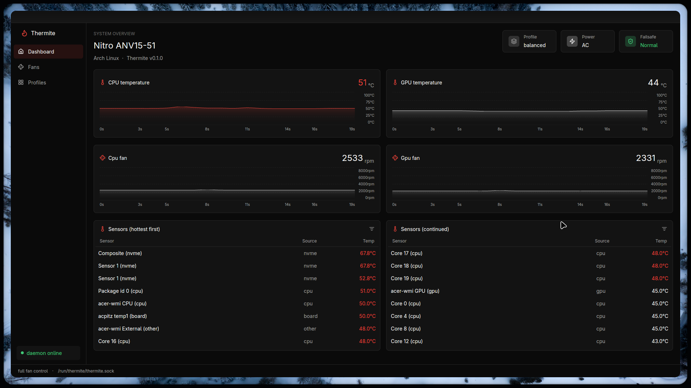
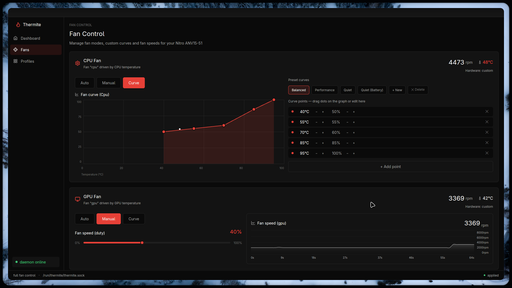
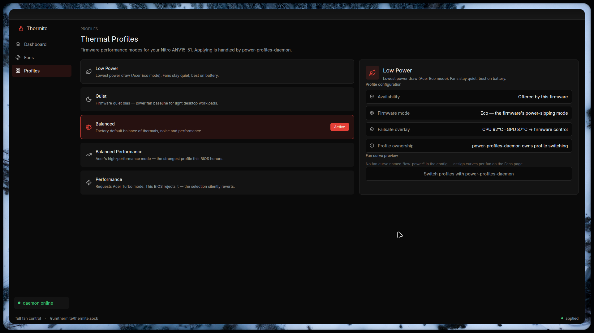

# Thermite

<p align="center">
  
</p>

**Thermal and fan management for Linux laptops** — a privileged daemon with
custom fan curves, layered thermal failsafes, performance profiles, live
monitoring, and a GPUI desktop GUI + CLI. Built driver-first: each laptop
family gets a small, honest driver, and the safety policy around it is
hardware-agnostic.

Thermite never writes to the Embedded Controller, hands control back to the
firmware when temperatures cross critical limits, and survives firmware
overrides, suspend/resume, and crashes by design — see
[Safety](docs/SAFETY.md).

## Screenshots

| Fans & curves | Profiles |
|---|---|
|  |  |

## Device support

| Device | Status | Via |
|---|---|---|
| Acer Nitro V 15 (ANV15-51) | ✅ **fully tested** — independent fan control, curves, profiles | `acer-wmi` (kernel 7.3+) or the [stopgap DKMS module](driver/acer-wmi-anv15/) on 7.2 |
| Other Acer Nitro / Predator with the acer-wmi gaming quirk | 🔶 should work, untested | same |
| ASUS laptops | 🔶 driver wanted — see [the driver guide](docs/DRIVERS.md) | — |
| HP / other vendors | 🔶 driver wanted | — |

Getting a laptop supported is designed to be a small, testable contribution:
read [`docs/DRIVERS.md`](docs/DRIVERS.md).

## How it works

```
crates/
├── thermite-core     # pure policy: curves, hysteresis, failsafes, config
├── thermite-proto    # versioned IPC over a Unix socket (CLI + GUI clients)
├── thermite-backend  # device drivers (drivers/ registry) + hwmon + NVML
├── thermite-daemon   # control loop, failsafes, IPC server (runs as root)
├── thermite-cli      # `thermite` command-line client
└── thermite-gui      # GPUI desktop client
```

- **Fan curves** — per-fan piecewise-linear temperature→duty curves with
  hysteresis (no fan chatter), duty floors, and battery variants
  (`balanced-battery` is picked automatically on battery).
- **Modes** — per fan: firmware auto, fixed manual %, or curve. Manual duty
  is re-asserted every 2 s so firmware overrides don't stick; drift is
  detected and alerted.
- **Failsafes** — warn threshold forces 100% duty; crit threshold hands the
  fan back to the firmware's own controller and latches until temperatures
  recover. Curves are validated before use; 0-RPM above configurable temps is
  impossible.
- **Suspend/resume** — fans restored to auto before sleep; writes held for a
  grace window after resume while the EC reinitializes.
- **Profiles** — platform profiles when the firmware offers them, or full
  hands-off (`[platform] active = "none"`) to coexist with
  power-profiles-daemon.
- **No EC writes, ever.** Full reasoning in
  [`docs/INVESTIGATION.md`](docs/INVESTIGATION.md) and
  [`docs/HARDWARE.md`](docs/HARDWARE.md).

## Install

### From source

```sh
git clone https://github.com/Shanu-Kumawat/Thermite.git
cd Thermite
cargo build --release -p thermite-daemon -p thermite-cli -p thermite-gui
sudo bash scripts/thermite-setup.sh   # service + group + config; idempotent
# undo: sudo bash scripts/thermite-remove.sh   (--keep-app keeps the app)
```

The setup script also installs the stopgap DKMS module when your kernel
predates the in-tree acer-wmi quirk (ANV15-51 on kernel 7.2). Arch users:
PKGBUILDs are in [`packaging/`](packaging/) (AUR packages planned).

### Check what your machine supports

```sh
thermite doctor   # driver match, capability level, sensors, profiles — no root needed
```

## Quick start

```sh
thermite status                  # snapshot: temps, fans, failsafe phase
thermite monitor                 # live view
thermite fan list                # fans your driver reports
thermite fan set cpu curve balanced
thermite fan set cpu manual 55   # percent duty
thermite fan set cpu auto        # back to firmware control
thermite profile list
thermite-gui                     # desktop app (join the `thermite` group first)
```

Configuration lives at `/etc/thermite/thermite.toml` (strictly validated; see
[`examples/thermite.toml`](examples/thermite.toml)). Runtime changes made
from the GUI/CLI persist across daemon restarts.

## Documentation

- [`docs/SAFETY.md`](docs/SAFETY.md) — the failsafe design and the things
  Thermite deliberately never does
- [`docs/DRIVERS.md`](docs/DRIVERS.md) — adding support for a new laptop
- [`docs/ARCHITECTURE.md`](docs/ARCHITECTURE.md) — crates, IPC, control loop
- [`docs/HARDWARE.md`](docs/HARDWARE.md) — ANV15-51 findings: WMI vs EC,
  profile semantics, firmware quirks
- [`docs/INVESTIGATION.md`](docs/INVESTIGATION.md) — the evidence base

## Contributing

Bug reports, new device drivers, and curve/profile experience reports are all
welcome — see [`CONTRIBUTING.md`](CONTRIBUTING.md). For new laptops,
[`docs/DRIVERS.md`](docs/DRIVERS.md) walks through probing your hardware and
writing a driver in ~150 lines, with tests that need no hardware.

## License

MIT — see [LICENSE](LICENSE). The stopgap kernel module in
[`driver/acer-wmi-anv15/`](driver/acer-wmi-anv15/) is a patched copy of
GPL-2.0 kernel source and remains GPL-2.0-only.
